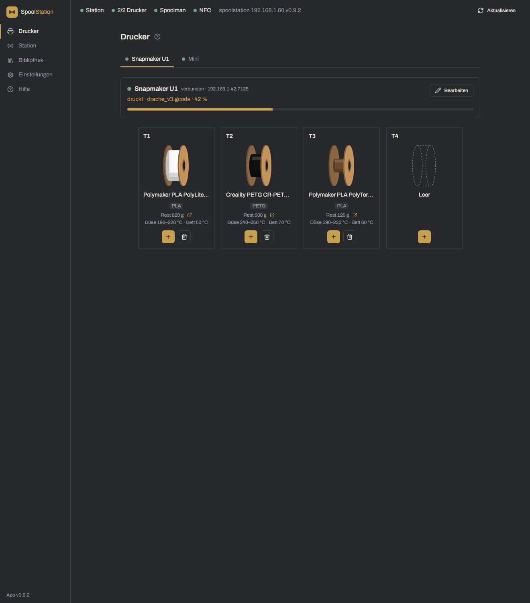
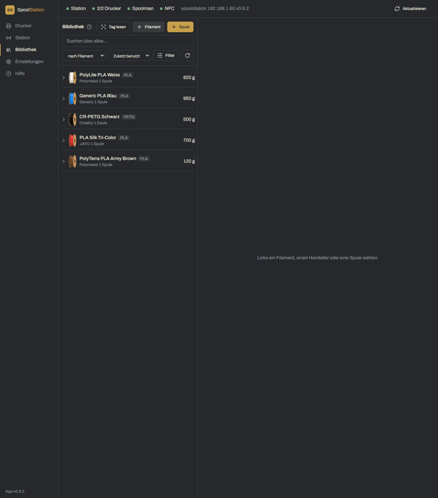
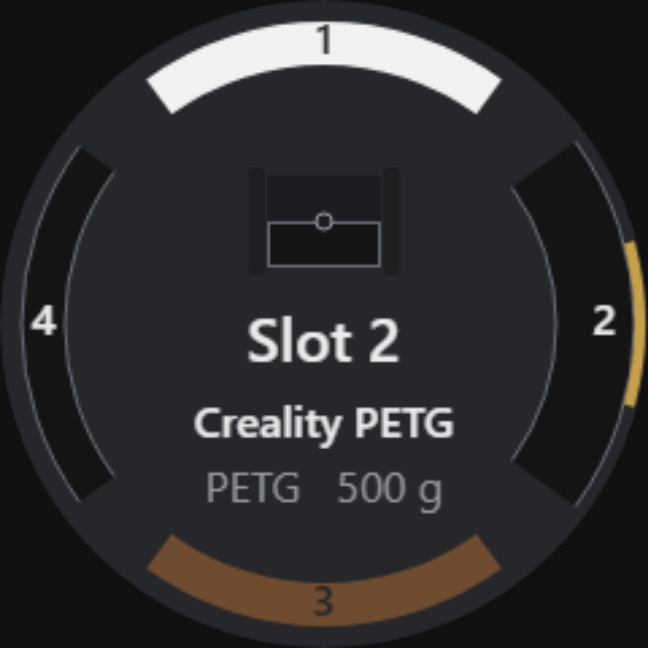

# SpoolStation

> 🇬🇧 This page is also available in [English](README.md).

SpoolStation ist ein kleines Selbstbau-Gerät plus eine Desktop-App, die **NFC-Filament-Tags**, **[Spoolman](https://github.com/Donkie/Spoolman)** und deinen **Snapmaker U1** zusammenbringt.

Du baust eine kleine ESP32-„Station" mit NFC-Leser, rundem Display und Drehknopf. Auf jede Spule klebst du einen NFC-Tag, beschreibst ihn einmal mit den Filamentdaten – und ab dann: Spule auf die Station legen, auf einen Drucker-Slot drehen, drücken – das Filament geht an den Drucker und der Verbrauch wird in Spoolman gebucht. Am PC verwaltet die App deine Spulen, Filamente und Hersteller und beschreibt die Tags.

> ⚠️ Dies ist ein eigenständiges Community-Projekt. Es steht in **keiner Verbindung zu Snapmaker** und wird von Snapmaker weder unterstützt noch empfohlen.

## Screenshots

| Drucker-Slots | Bibliothek |
| --- | --- |
|  |  |

Das Gerät selbst:



## Funktionen

- **NFC-Tags für deine Spulen** – OpenSpool-Daten auf NTAG215-Tags schreiben und mit Spoolman-Spulen verknüpfen.
- **Laden per Knopfdruck** – am Gerät einen Slot wählen, Spule auflegen, und das Filament geht an den Snapmaker U1 und wird in Spoolman gebucht.
- **Drucker-Seite** – alle Slots (T1–T4) live mit Farbe, Material, Temperaturen und Restgewicht; Slots zuweisen oder leeren, mit oder ohne Tag.
- **Spoolman-Bibliothek** – Spulen, Filamente und Hersteller verwalten; wiegen, Verbrauch buchen, archivieren, duplizieren und löschen.
- **Filamentdatenbank** – Hersteller, Temperaturen, Dichte und Leergewicht aus der Online-SpoolmanDB übernehmen.
- **Bis zu vier Drucker** – das Gerät dreht durch alle Slots aller Drucker.
- **Einrichtungsassistent** – fabrikneuen ESP32 direkt aus der App per USB flashen und einrichten; keine Programmierumgebung, keine Konfigurationsdateien.
- **Updates per Funk** – App (GitHub-Releases) und Station-Firmware (OTA, mit Rollback-Schutz) aktualisieren.
- **Hilfe in der App** und **drei Sprachen** (Deutsch, Englisch, Spanisch), für App und Gerät.

## Voraussetzungen

- Ein **Snapmaker U1** mit der **[Paxx Extended Firmware](https://snapmakeru1-extended-firmware.pages.dev/)** und aktivierter Spoolman-Integration (nur nötig, um Filamente an den Drucker zu senden).
- Ein **Spoolman-Server** im Netzwerk (z. B. auf einem Raspberry Pi).
- Ein Windows-PC für die Desktop-App.
- Die Selbstbau-Station (Teile siehe unten). Station, Spoolman und Drucker hängen im selben **2,4-GHz-WLAN**.

## Teile (Kurzliste)

- ESP32 DevKit (ESP32-WROOM-32, 30 Pin, CH340) + ein 30-Pin-Schraubklemmen-Adapter
- PN532 NFC-Modul V3
- Rundes Display GC9A01, 1,28", 240 × 240
- Drehencoder EC11 mit Drückfunktion
- NTAG215-NFC-Sticker (einer pro Spule)
- Silikonlitze, Aderendhülsen, Schrumpfschlauch, ein USB-C-Datenkabel und ein 5-V-Netzteil

Die vollständige Teileliste, Pinbelegung und Verkabelung stehen in der **[Bauanleitung](docs/hardware/BUILD.de.md)**.

## Schnellstart

1. **App installieren** – den aktuellen Windows-Installer unter [Releases](https://github.com/schmutzskuz/spoolstation/releases) herunterladen und ausführen.
2. **Station bauen** – der [Bauanleitung](docs/hardware/BUILD.de.md) folgen.
3. **Station einrichten** – beim ersten Start führt dich der Assistent: Spoolman-Adresse und Drucker eingeben, dann *„Neue Station einrichten (USB)"* wählen, ESP32 anstecken und flashen. WLAN wählen – fertig.
4. **Loslegen** – in der Bibliothek Spulen anlegen, Tags beschreiben und Filament am Gerät oder aus der App laden.

Alles Weitere erklärt die **Hilfe in der App** (Bereich „Hilfe" in der Seitenleiste).

## Selbst aus dem Quellcode bauen

Du brauchst [Node.js](https://nodejs.org/) (18+) und, für die Firmware, [PlatformIO](https://platformio.org/).

```bash
# Firmware (erzeugt factory.bin, ota.bin und das Manifest und kopiert sie in die App)
cd firmware
pio run

# Desktop-App
cd ../desktop
npm install
npm run dev        # Entwicklung
npm run test       # Tests
npm run build      # Produktionsbuild
npm run build:win  # Windows-Installer -> desktop/release/
```

`version.json` (version + api_version) und `update.config.json` (owner/repo für Releases) im Hauptordner sind die einzigen Quellen der Wahrheit. Die gemeinsame Version erhöhst du mit `npm run version:bump -- patch|minor|major` und baust danach die Firmware neu.

## Danksagungen

SpoolStation baut auf diesen Projekten auf:

- **[wasikuss/snapmaker-u1-remote-rfid-reader](https://github.com/wasikuss/snapmaker-u1-remote-rfid-reader)** – der ursprüngliche MicroPython-RFID-Reader, der dieses Projekt inspiriert und das Tag-Format sowie die Drucker-Schnittstelle vorgegeben hat.
- **[Paxx Extended Firmware](https://snapmakeru1-extended-firmware.pages.dev/)** (paxx12) – die Snapmaker-U1-Firmware mit Moonraker und der Spoolman-Integration, mit der dieses Projekt spricht.
- **[Spoolman](https://github.com/Donkie/Spoolman)** (Donkie) – die Filament-Spulendatenbank.
- **[SpoolmanDB](https://github.com/Donkie/SpoolmanDB)** – die Online-Filamentdatenbank für das schnelle Anlegen von Filamenten.
- **[OpenSpool](https://openspool.io/)** – das Datenformat der NFC-Tags.

## Lizenz

Veröffentlicht unter der [MIT-Lizenz](LICENSE) – © Florian. Die Lizenzen der verwendeten Bibliotheken stehen in [THIRD_PARTY_NOTICES.md](THIRD_PARTY_NOTICES.md).
