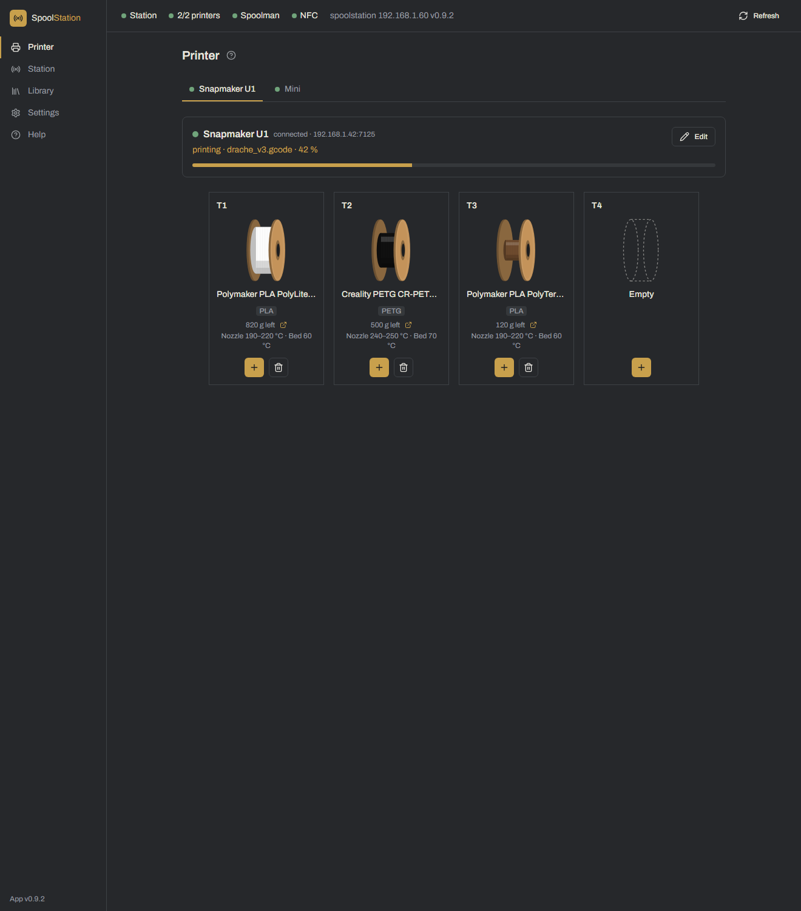
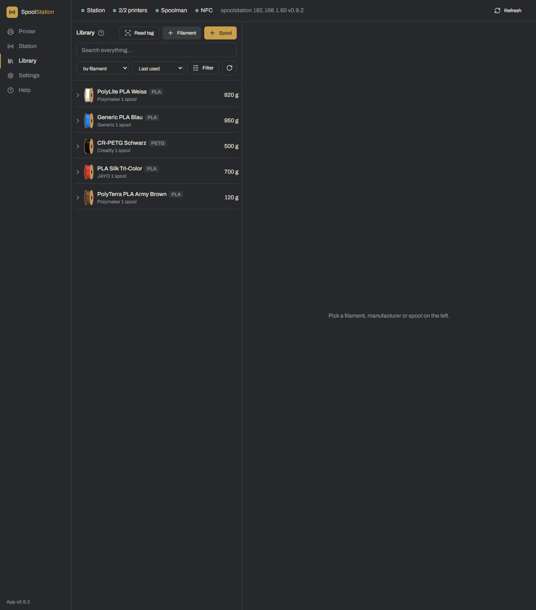
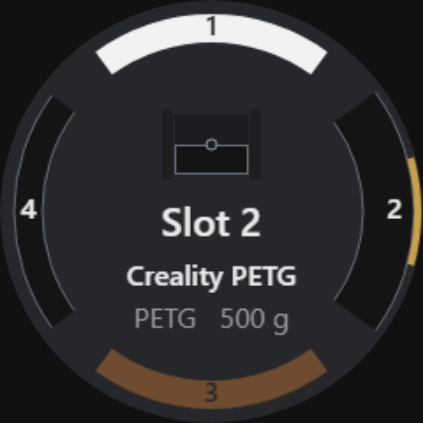

# SpoolStation

> 🇩🇪 Diese Seite gibt es auch auf [Deutsch](README.de.md).

SpoolStation is a small DIY device plus a desktop app that brings **NFC filament tags**, **[Spoolman](https://github.com/Donkie/Spoolman)** and your **Snapmaker U1** together.

Build a little ESP32 "station" with an NFC reader, a round display and a rotary knob. Stick an NFC tag on each spool, write its filament data once, and from then on: place the spool on the station, turn to a printer slot, press – and the filament is sent to the printer and its usage is tracked in Spoolman. On the PC, the app manages your spools, filaments and manufacturers and writes the tags.

> ⚠️ This is an independent, community-built project. It is **not affiliated with, endorsed by or supported by Snapmaker.**

## Screenshots

| Printer slots | Library |
| --- | --- |
|  |  |

The device itself:



## Features

- **NFC tags for your spools** – write OpenSpool data to NTAG215 tags and link them to Spoolman spools.
- **One-press loading** – choose a slot at the device, place the spool, and the filament is sent to the Snapmaker U1 and booked in Spoolman.
- **Printer page** – see all filament slots (T1–T4) live, with colour, material, temperatures and remaining weight; assign or clear slots, with or without a tag.
- **Spoolman library** – manage spools, filaments and manufacturers; weigh, log usage, archive, duplicate and delete.
- **Filament database** – pull manufacturer, temperatures, density and empty weight from the online SpoolmanDB.
- **Up to four printers** – the device cycles through all slots of all printers.
- **Setup wizard** – flash and provision a brand-new ESP32 straight from the app over USB; no IDE, no config files.
- **Over-the-air updates** – update the app (GitHub releases) and the station firmware (OTA, with rollback protection).
- **In-app help** and **three languages** (German, English, Spanish), for both the app and the device.

## Requirements

- A **Snapmaker U1** running the **[Paxx Extended Firmware](https://snapmakeru1-extended-firmware.pages.dev/)** with the Spoolman integration enabled (only needed to send filaments to the printer).
- A **Spoolman server** on your network (e.g. on a Raspberry Pi).
- A Windows PC for the desktop app.
- The DIY station (see parts below). Station, Spoolman and the printer share the same **2.4 GHz** Wi-Fi.

## Parts (short list)

- ESP32 DevKit (ESP32-WROOM-32, 30-pin, CH340) + a 30-pin screw-terminal adapter
- PN532 NFC module V3
- Round GC9A01 display, 1.28", 240 × 240
- EC11 rotary encoder with push button
- NTAG215 NFC stickers (one per spool)
- Silicone wire, ferrules, heat-shrink, a USB-C data cable and a 5 V power supply

The full parts list, pinout and wiring are in the **[build guide](docs/hardware/BUILD.en.md)**.

## Quick start

1. **Install the app** – download the latest Windows installer from the [releases](https://github.com/schmutzskuz/spoolstation/releases) and run it.
2. **Build the station** – follow the [build guide](docs/hardware/BUILD.en.md).
3. **Set up the station** – on first launch the wizard guides you: enter your Spoolman address and printer, then choose *"Set up new station (USB)"*, plug in the ESP32 and flash it. Pick your Wi-Fi and you're done.
4. **Use it** – create spools in the library, write tags, and load filament at the device or from the app.

Everything else is explained in the **in-app help** (the "Help" section in the sidebar).

## Build from source

You need [Node.js](https://nodejs.org/) (18+) and, for the firmware, [PlatformIO](https://platformio.org/).

```bash
# Firmware (produces factory.bin, ota.bin and the manifest, and copies them into the app)
cd firmware
pio run

# Desktop app
cd ../desktop
npm install
npm run dev        # development
npm run test       # tests
npm run build      # production build
npm run build:win  # Windows installer -> desktop/release/
```

`version.json` (version + api_version) and `update.config.json` (owner/repo for releases) in the project root are the single sources of truth. Bump the shared version with `npm run version:bump -- patch|minor|major` and rebuild the firmware.

## Acknowledgements

SpoolStation stands on the shoulders of these projects:

- **[wasikuss/snapmaker-u1-remote-rfid-reader](https://github.com/wasikuss/snapmaker-u1-remote-rfid-reader)** – the original MicroPython RFID reader that inspired this project and informed the tag format and printer interface.
- **[Paxx Extended Firmware](https://snapmakeru1-extended-firmware.pages.dev/)** (paxx12) – the Snapmaker U1 firmware with Moonraker and the Spoolman integration this project talks to.
- **[Spoolman](https://github.com/Donkie/Spoolman)** (Donkie) – the filament spool database.
- **[SpoolmanDB](https://github.com/Donkie/SpoolmanDB)** – the online filament database used for quick filament creation.
- **[OpenSpool](https://openspool.io/)** – the NFC tag data format.

## License

Released under the [MIT License](LICENSE) – © Florian. See [THIRD_PARTY_NOTICES.md](THIRD_PARTY_NOTICES.md) for the licenses of the libraries used.
